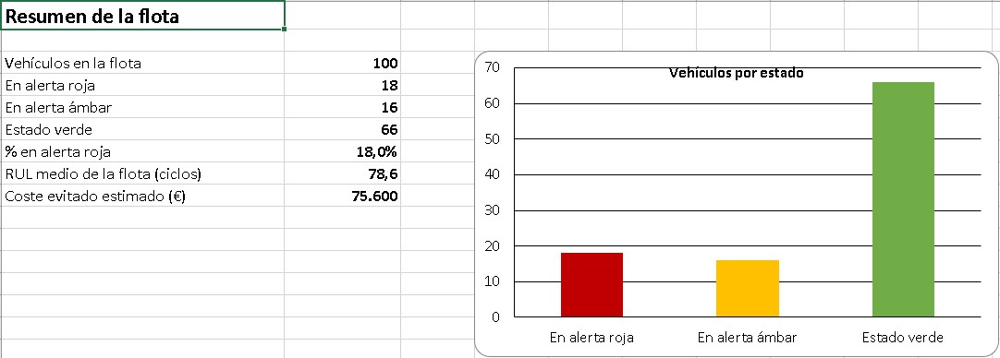
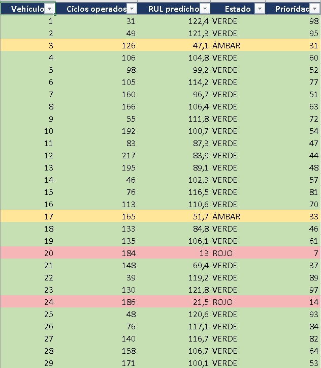
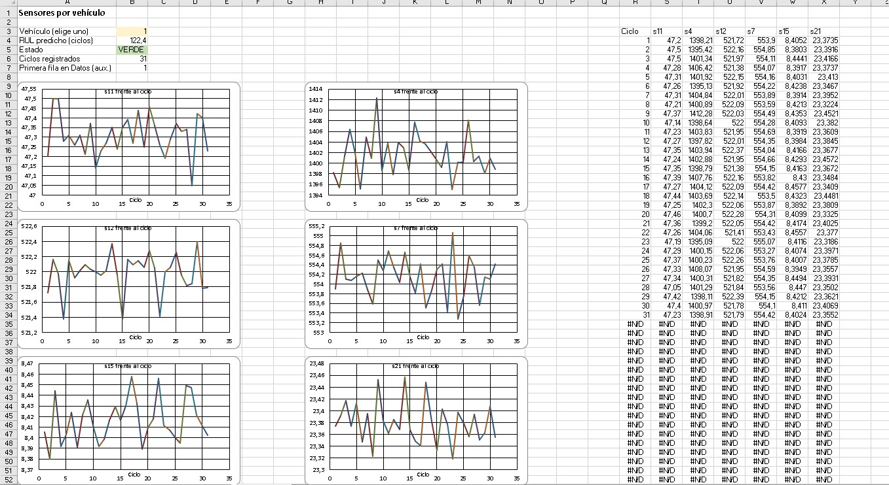
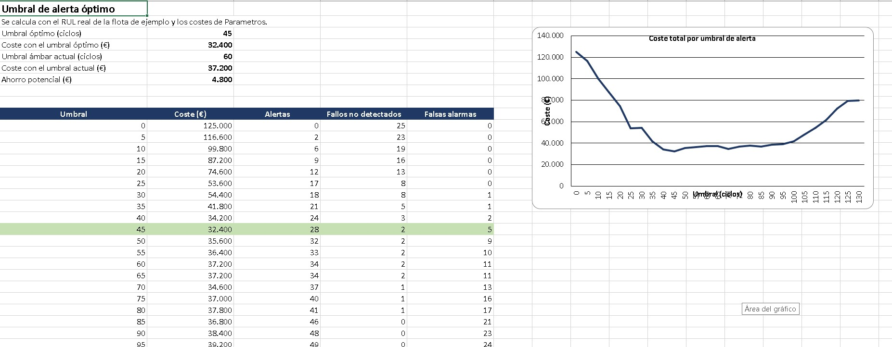
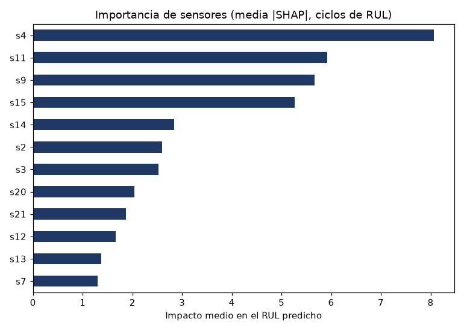
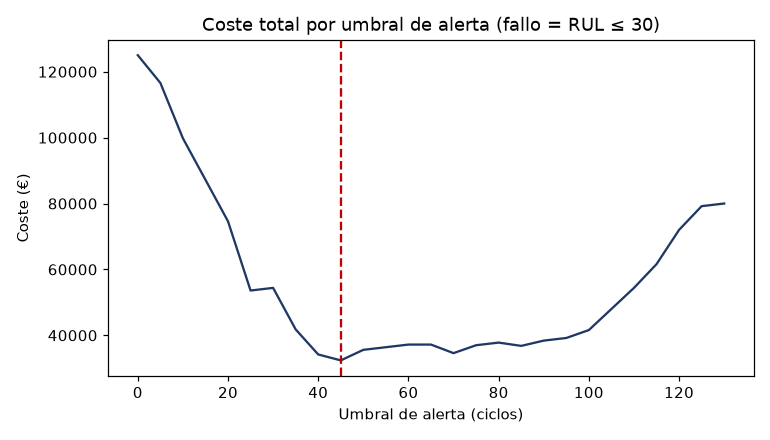

# Predictive-Maintenance


Mantenimiento predictivo para talleres y flotas: predice la **vida útil restante (RUL)** de cada vehículo a partir de sensores y genera un **dashboard en Excel** con alertas y KPIs para el jefe de taller.

Proyecto personal de ciencia de datos sobre el dataset NASA C-MAPSS (turbofan), donde cada motor representa un vehículo y cada ciclo una jornada de uso.

## Qué incluye

- **Datos y features:** carga de C-MAPSS, cálculo del RUL con *clipping* a 125 ciclos, medias móviles, pendientes móviles y normalización de sensores.
- **Sin fuga de datos:** el scaler se ajusta solo con train y la validación cruzada agrupa por motor (`GroupKFold`).
- **Modelos:** regresión lineal, Random Forest y LightGBM.
- **Subconjuntos FD001 a FD004:** normalización por condición operativa (KMeans sobre los settings) para los subconjuntos con 6 regímenes de vuelo.
- **Dashboard Excel** con fórmulas vivas: umbrales y costes editables en la hoja `Parametros`, y todo se recalcula.
- **Hoja Sensores** con desplegable de vehículo y 6 gráficos de degradación.
- **Interpretabilidad (SHAP):** la hoja Flota muestra los 3 sensores que más reducen el RUL de cada vehículo.
- **Umbral de alerta óptimo** calculado con costes, y hoja Umbral que lo recalcula en Excel.
- **API FastAPI**, página web local y Dockerfile.
- **CI** con GitHub Actions (tests en cada PR).

## Resultados (test FD001, 100 motores)

| Modelo | RMSE | MAE | Score NASA |
|---|---|---|---|
| Regresión lineal | 20.44 | 15.90 | 1084 |
| Random Forest | 18.21 | 13.19 | 1005 |
| **LightGBM** | **17.41** | **12.28** | 1028 |

LightGBM mejora el error medio, pero el score NASA (que penaliza más predecir tarde que pronto) no mejora respecto al Random Forest. La validación cruzada por motor da un RMSE de 17.8 ± 0.5, coherente con el test.

### Resultados por subconjunto (LightGBM)

| Subconjunto | Condiciones | RMSE | MAE | Score NASA |
|---|---|---|---|---|
| FD001 | 1 | 17.41 | 12.27 | 1028 |
| FD002 | 6 | 16.06 | 11.68 | 1441 |
| FD003 | 1 | 18.82 | 12.18 | 1488 |
| FD004 | 6 | 19.14 | 13.84 | 2955 |

FD002 y FD004 mezclan 6 condiciones operativas: los sensores se normalizan por condición antes de calcular medias y pendientes móviles. El score NASA es una suma sobre los motores de test, que son 100, 259, 100 y 248 respectivamente, así que no es comparable entre subconjuntos; RMSE y MAE sí.

## Capturas

### Web local


### Dashboard Excel

**Resumen**



**Flota**



**Alertas**


**Sensores** (desplegable de vehículo y gráficos de degradación)



**Umbral** (el óptimo se recalcula al cambiar los costes)



### Interpretabilidad
Cada vehículo muestra los sensores que más reducen su RUL (valores SHAP de LightGBM).



## Umbral de alerta óptimo

Con los costes de ejemplo (5.000 € por parada no planificada y 800 € por preventivo) y considerando fallo un RUL real ≤ 30 ciclos, el umbral que minimiza el coste total en los 100 motores de test es **45 ciclos** (coste ≈ 32.000 €).

La curva es plana entre 45 y 90 ciclos, así que cualquier umbral de ese rango es razonable. El óptimo queda por encima del horizonte de fallo (30) porque el modelo tiene error y una parada cuesta más que un preventivo.



Es una estimación sobre pocos vehículos; en un taller real habría que recalibrarla con su histórico y sus costes.

## Dashboard Excel

| Hoja | Contenido |
|---|---|
| Resumen | KPIs (vehículos, % en rojo, RUL medio, coste evitado) y gráfico |
| Flota | RUL predicho por vehículo con semáforo, prioridad y sensores clave |
| Alertas | Vehículos críticos ordenados por urgencia |
| Umbral | Curva de coste por umbral, umbral óptimo y ahorro potencial |
| Sensores | Evolución de sensores clave del vehículo elegido |
| Parametros | Umbrales, costes y horizonte de fallo (celdas amarillas editables) |
| Datos | Lecturas en bruto que alimentan la hoja Sensores |

Por defecto: rojo si RUL < 30 ciclos, ámbar si < 60. Los costes (5.000 € por parada no planificada, 800 € por mantenimiento preventivo) son valores de ejemplo y se pueden cambiar.

> Al abrir el Excel descargado, pulsa **Habilitar edición** para que se calculen las fórmulas.

## Estructura

```
├── app/          # API FastAPI y página web (app/static)
├── data/         # raw (no se sube) y processed
├── docs/         # capturas y gráficos del README
├── notebooks/    # EDA
├── reports/      # Excel generado (no se sube)
├── src/
│   ├── data/     # carga de datos
│   ├── features/ # RUL, medias, pendientes, scaler, condiciones
│   ├── models/   # métricas, CV, baseline, LightGBM, SHAP, umbral, multi-subconjunto
│   └── reports/  # predicción de flota y generador de Excel
└── tests/
```

## Cómo ejecutarlo

1. Clona el repo y crea el entorno:
   ```bash
   python -m venv .venv
   source .venv/Scripts/activate   # Git Bash en Windows
   pip install -r requirements.txt
   ```
2. Descarga el dataset [NASA Turbofan Jet Engine Data Set](https://www.kaggle.com/datasets/behrad3d/nasa-cmaps) y copia los archivos `train_FD00X.txt`, `test_FD00X.txt` y `RUL_FD00X.txt` a `data/raw/` (con FD001 basta para el dashboard).
3. Entrena los modelos:
   ```bash
   python -m src.models.baseline
   python -m src.models.advanced
   ```
4. Genera el Excel:
   ```bash
   python -m src.reports.build_excel
   ```
   Se crea en `reports/dashboard_flota.xlsx`.
5. (Opcional) Análisis adicionales:
   ```bash
   python -m src.models.explain      # importancia de sensores (SHAP)
   python -m src.models.threshold    # umbral de alerta óptimo
   python -m src.models.multi        # resultados FD001 a FD004
   ```
6. (Opcional) Arranca la API y la web local:
   ```bash
   uvicorn app.main:app --reload
   ```
   Web en `http://127.0.0.1:8000/` y documentación en `http://127.0.0.1:8000/docs`.
7. (Opcional) Con Docker: `docker build -t predictive-maintenance .` (descarga los modelos de la release v0.1.0).

## Tests

```bash
python -m pytest -v
```

## Limitaciones

- El dashboard y la API usan solo FD001.
- Datos simulados de motores de avión, usados como analogía de una flota.
- La hoja Umbral solo existe para la flota de ejemplo, porque necesita el RUL real.
- El Excel de la API (`/report`) no incluye las hojas Sensores y Datos.
- El umbral óptimo se calcula sobre 100 motores de test: es una estimación.

## Posibles mejoras

- Intervalos de incertidumbre en el RUL (regresión cuantílica).
- Tuning y más features para FD004.
- Dashboard y API compatibles con FD002 a FD004.

## Datos y licencia

Dataset: A. Saxena y K. Goebel (2008), *Turbofan Engine Degradation Simulation Data Set*, NASA Ames Prognostics Data Repository.
Licencia MIT (ver [LICENSE](LICENSE)).
