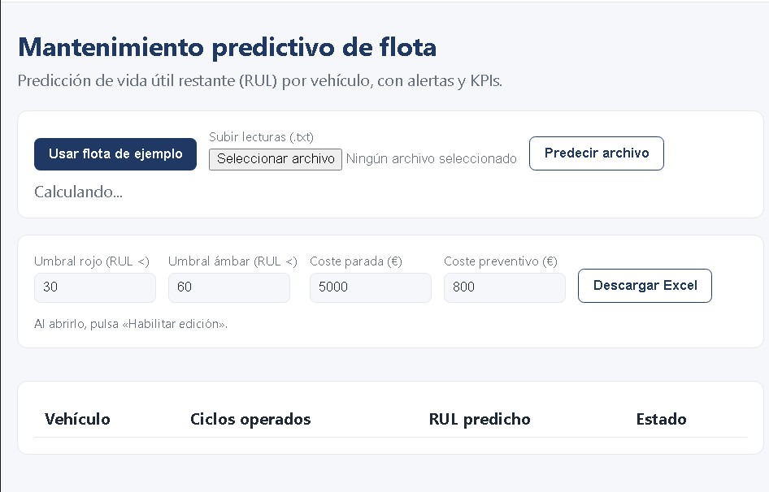
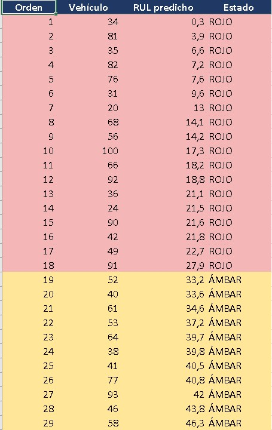
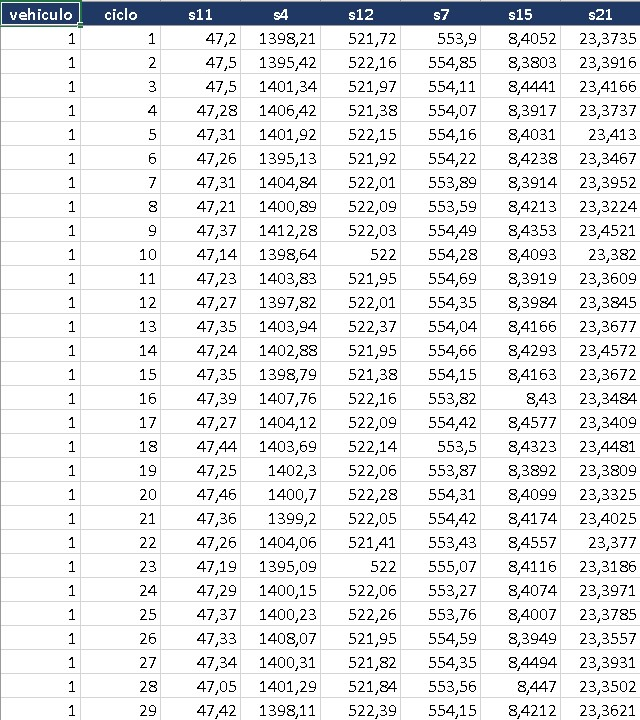

# Predictive-Maintenance


Mantenimiento predictivo para talleres y flotas: predice la **vida útil restante (RUL)** de cada vehículo a partir de sensores y genera un **dashboard en Excel** con alertas y KPIs para el jefe de taller.

Proyecto personal de ciencia de datos sobre el dataset NASA C-MAPSS (turbofan), donde cada motor representa un vehículo y cada ciclo una jornada de uso.

## Qué incluye

- **Datos y features:** carga de C-MAPSS FD001, cálculo del RUL con *clipping* a 125 ciclos, medias móviles, pendientes móviles y normalización por sensor.
- **Sin fuga de datos:** el scaler se ajusta solo con train y la validación cruzada agrupa por motor (`GroupKFold`).
- **Modelos:** regresión lineal, Random Forest y LightGBM.
- **Dashboard Excel** con fórmulas vivas: umbrales y costes editables en la hoja `Parametros`, y todo se recalcula (estado, alertas, KPIs).
- **API FastAPI** y una página web local para subir lecturas y ver el semáforo.
- **Hoja Sensores** con desplegable de vehículo y 6 gráficos de degradación.
- **Interpretabilidad (SHAP):** la hoja Flota muestra los 3 sensores que más reducen el RUL de cada vehículo.

## Resultados (test FD001, 100 motores)

| Modelo | RMSE | MAE | Score NASA |
|---|---|---|---|
| Regresión lineal | 20.44 | 15.90 | 1084 |
| Random Forest | 18.21 | 13.19 | 1005 |
| **LightGBM** | **17.41** | **12.28** | 1028 |

LightGBM mejora el error medio, pero el score NASA (que penaliza más predecir tarde que pronto) no mejora respecto al Random Forest. La validación cruzada por motor da un RMSE de 17.8 ± 0.5, coherente con el test.

## Dashboard Excel

| Hoja | Contenido |
|---|---|
| Resumen | KPIs (vehículos, % en rojo, RUL medio, coste evitado) y gráfico |
| Flota | RUL predicho por vehículo con semáforo y prioridad |
| Alertas | Vehículos críticos ordenados por urgencia |
| Parametros | Umbrales rojo/ámbar y costes (celdas amarillas editables) |
| Sensores | Evolución de sensores clave del vehículo elegido |
| Datos | Lecturas en bruto que alimentan la hoja Sensores |

Por defecto: rojo si RUL < 30 ciclos, ámbar si < 60. Los costes (5.000 € por parada no planificada, 800 € por mantenimiento preventivo) son valores de ejemplo y se pueden cambiar.

> Al abrir el Excel descargado, pulsa **Habilitar edición** para que se calculen las fórmulas.

## Estructura

```
├── app/          # API FastAPI y página web (app/static)
├── data/         # raw (no se sube) y processed
├── notebooks/    # EDA
├── reports/      # Excel generado (no se sube)
├── src/
│   ├── data/     # carga de datos
│   ├── features/ # RUL, medias, pendientes, scaler
│   ├── models/   # métricas, CV, baseline, LightGBM
│   └── reports/  # predicción de flota y generador de Excel
└── tests/
```

## Cómo ejecutarlo

1. Clona el repo y crea el entorno:
   ```bash
   python -m venv .venv
   source .venv/Scripts/activate   # Git Bash en Windows
   pip install -r requirements.txt
   ```
2. Descarga el dataset [NASA Turbofan Jet Engine Data Set](https://www.kaggle.com/datasets/behrad3d/nasa-cmaps) y copia `train_FD001.txt`, `test_FD001.txt` y `RUL_FD001.txt` a `data/raw/`.
3. Entrena los modelos:
   ```bash
   python -m src.models.baseline
   python -m src.models.advanced
   ```
4. Genera el Excel:
   ```bash
   python -m src.reports.build_excel
   ```
   Se crea en `reports/dashboard_flota.xlsx`.
5. (Opcional) Arranca la API y la web local:
   ```bash
   uvicorn app.main:app --reload
   ```
   Web en `http://127.0.0.1:8000/` y documentación en `http://127.0.0.1:8000/docs`.

## Tests

```bash
python -m pytest -v
```

## Capturas

### Web local


**Resumen**


**Flota**


**Alertas**



**Sensores** (desplegable de vehículo y gráficos de degradación)


**Datos**
 

### Interpretabilidad
Cada vehículo muestra los sensores que más reducen su RUL (valores SHAP de LightGBM).


## Umbral de alerta óptimo

Con los costes de ejemplo (5.000 € por parada no planificada y 800 € por preventivo) y considerando fallo un RUL real ≤ 30 ciclos, el umbral que minimiza el coste total en los 100 motores de test es **X ciclos** (coste Y €).


Es una estimación sobre pocos vehículos; en un taller real habría que recalibrarla con su histórico y sus costes.

## Limitaciones

- Solo FD001 (una condición operativa y un modo de fallo).
- Datos simulados de motores de avión, usados como analogía de una flota.
- El botón de Excel de la web genera el informe de la flota de ejemplo, no del archivo subido.

## Posibles mejoras

- Subconjuntos FD002 a FD004.
- Intervalos de incertidumbre en el RUL e interpretabilidad con SHAP.
- Hoja de sensores con gráficos de degradación por vehículo.
- Integración continua con GitHub Actions.
- Mejorar en la web local.

## Datos y licencia

Dataset: A. Saxena y K. Goebel (2008), *Turbofan Engine Degradation Simulation Data Set*, NASA Ames Prognostics Data Repository.
Licencia MIT (ver [LICENSE](LICENSE)).
